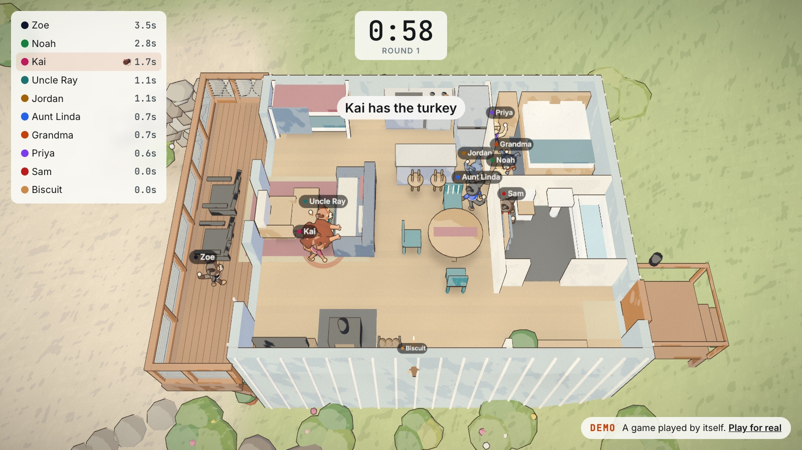
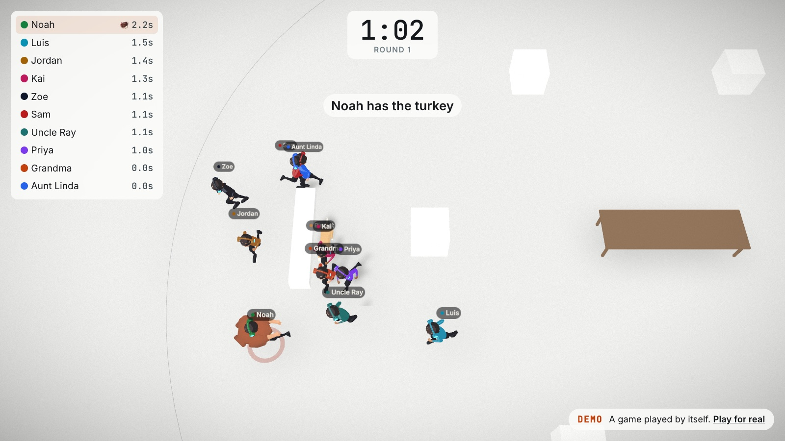
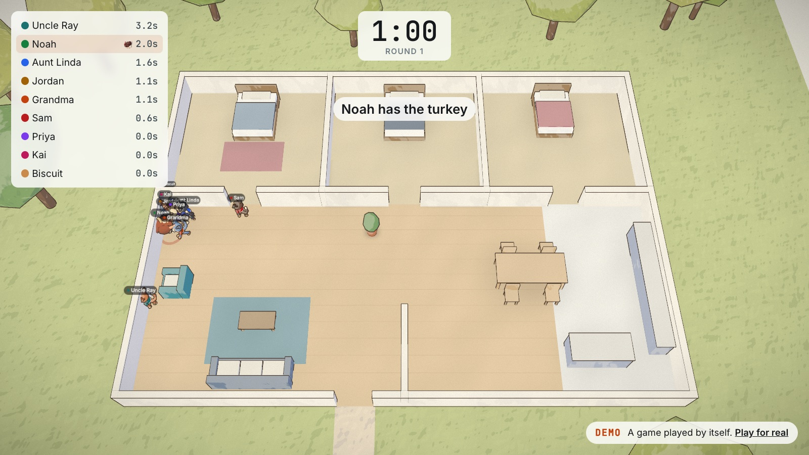
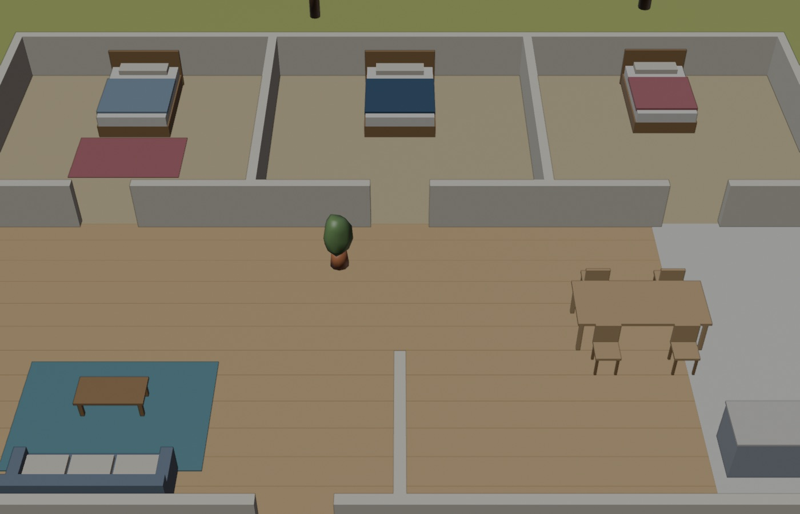
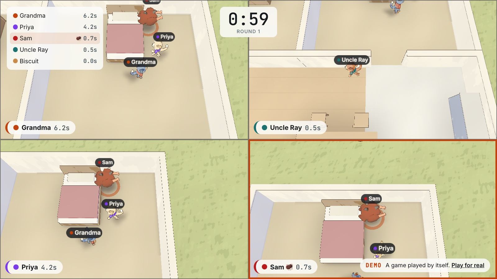
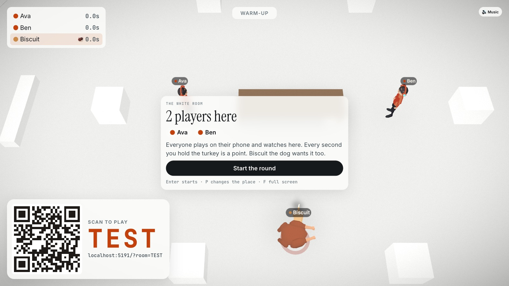
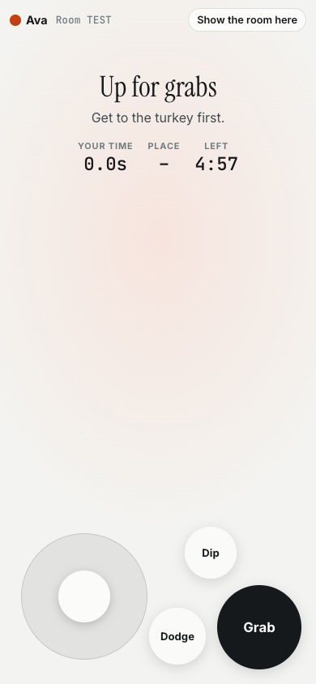

# Grab the Turkey

**Build your house. Play in it after dinner.**



*The Carriage House, a real home built with the workflow below: a floor plan and a few photos, turned into a painted model by headless Blender, and played on the TV from above while everyone runs their pup from their phone.*

Grab the Turkey is a party game for one room full of people. Everyone opens a link on their phone, types a name, and chases the turkey. **Every second you hold it is a point.** Rounds last five minutes. Biscuit the dog wants the turkey too.

The game is the easy part. The fun is that **it can happen in your house**. Give it a floor plan and some photos, and a script builds your rooms, furniture and yard in the game's storybook style. Then put it on the TV, and the family sees itself running around its own living room.

- **On phones:** open the link, play. No app, no account, no server.
- **On the TV:** the whole house from above with the roof off, a QR code to join, and a live leaderboard. Phones become controllers.
- **In your own world:** your home, your office, your cabin, from a floor plan, with headless Blender doing the modeling. [Start here](#build-your-own-world).

## Build your own world

| The White Room | A painted home |
|---|---|
|  |  |
| **The plain world.** An endless white floor, a table, a few plinths and full-size figures. There's nothing to build, and it plays anywhere. Start here if you just want a game tonight. Describe your own boxes in one TypeScript file and you have a quick, plain version of any room. | **Your home, drawn.** The Example Home was built entirely by the workflow below from [one plan file](homes/example-home/plan.json). Painted walls and floors, ink outlines, furniture, a yard, and a roof that lifts off when the game starts. Child-size pups play here, so there's room to run between the couch and the table. |

### The workflow: floor plan and photos to a playable home

You don't need to know Blender. The model is built by a script, headless, from plain data, and a coding agent can write that data for you from your pictures.

**1. Gather pictures of the place.** A floor plan with dimensions (a listing's plan, the county's footprint, a phone LiDAR scan or a tape measure) and a handful of photos of each room. The plan gives the walls. The photos give the furniture and the colors.

**2. Write the plan.** One JSON file, in meters, with (0, 0) at the middle of the house: the outside, the walls (with doors and windows), the rooms' floors, the furniture, and where the turkey starts. Copy [`homes/example-home/plan.json`](homes/example-home/plan.json). Or hand the pictures to a coding agent (Claude Code, Codex, Cursor) with a prompt like this:

> Here is a floor plan of my home and photos of each room. Write `homes/my-home/plan.json` in the format of `homes/example-home/plan.json` (the format is documented at the top of `blender/home.py`). Measure the walls from the plan, put the doors and windows where they are, place the big furniture from the photos, and pick colors that match. Then build it with headless Blender, look at the preview renders, fix anything that's off, and add it to the game as an environment like `src/env/example-home.ts`.

**3. Build it in headless Blender.** [Blender](https://www.blender.org) is free. Nothing opens on screen:

```bash
blender -b --factory-startup --python-exit-code 1 --python blender/home.py -- homes/my-home/plan.json --preview build/previews
```

The script writes the model (`public/models/my-home.glb`) and the collision boxes that match it (`src/env/my-home.layout.json`), so what you see is what you bump into. `--preview` also renders a quick still of the outside and of the open dollhouse to check against your photos:



**4. Add it and play.** Copy [`src/env/example-home.ts`](src/env/example-home.ts) to `src/env/my-home.ts`, change the ids, and add it to the list in [`src/env/index.ts`](src/env/index.ts). Run `npm run dev`, choose your home in **Where you are playing**, and walk the rooms. Fix the plan and rebuild until the doors feel right.

**Going further.** `home.py` builds a good house from boxes. The Carriage House went further, with a deck, stairs, a stove, a pond and stone walls. That came from a hand-written Blender script built on the same helpers ([`blender/lib.py`](blender/lib.py)), written by a coding agent working from the photos. Anything you can describe, it can build. Name the parts the game should outline in ink `o_…`, and put them in three groups: `GRP_Lower` (floor, furniture), `GRP_Upper` (upper walls and roof, lifted off in play) and `GRP_Site` (yard and trees).

The full guide, from measuring a floor plan to testing the doors, is **[docs/BUILD-YOUR-HOME.md](docs/BUILD-YOUR-HOME.md)**.

### Big worlds and more than one floor: plan for the TV

The overhead TV view is built for **one floor of a house**, about the size of the Carriage House's upper floor. In a space that size, everyone is readable at once on one screen.

Be careful going bigger:

- **A big world.** A house plus a yard, or a whole office. Players spread out, and one shot that holds everyone makes everyone tiny. The TV camera follows the chase in a big place, but people at opposite ends of the world can't both be seen well.
- **More than one level.** An upstairs and a downstairs, or a deck with stairs down to the yard. Some players will be inside and some outside, and one overhead shot can't show both floors at once.

For worlds like these, **use split screen**. The TV gives each player their own pane, following them wherever they are, with their name, their time, and a highlight on whoever has the turkey. Set `screen: 'split'` in the place's file, or add `?split` to the TV's address.



One more thing to know: the game itself plays on **one level** today. Players run on one floor, and the turkey can land on tables. Stairs between floors are not built in yet. A multi-level house can be played one floor at a time as separate places, or someone can add heights to the game and send a pull request.

## Play on the TV

| The TV | Each phone |
|---|---|
|  |  |

1. On the TV (or a laptop plugged into it), open the site and press **📺 Put it on the TV**, or go straight to `/?tv`. It makes a room and shows its code and a QR code.
2. Everyone scans the QR code, types a name and joins. Each phone turns into a **controller**: the stick, the buttons, and big words about what is happening to you (you have the turkey, your time, your place). Up on the stick is up on the TV. The phone buzzes when you get the turkey and when it's taken.
3. Press **Start the round** on the TV (or Enter) or on any phone. With a TV in the room, rounds run back to back: the results show for 15 seconds, then the next countdown starts.

The TV shows the whole place from above, with the roof off in a painted house, plus the leaderboard and the clock. Keys on the TV: Enter starts, P changes the place, F goes full screen.

The TV **hosts the game**: it runs the turkey, the dog and the clock. It never sleeps and never plays, so the game stays smooth while phones lock and come back. If the TV is turned on mid-round, it waits to hear the game before taking over, so nobody loses their score. If it goes off, a phone takes over.

A phone can still show the room: **Show the room here** on the controller (or **📺 Watch the TV** to go back). `?pad` forces the controller. To put an existing room on the TV, open `/?tv=ABCD` with its code. The lobby on every phone shows that address.

**The demo:** **▶ Watch a demo** on the start page, or `/?demo`, plays a whole game from above with made-up players, round after round. It's for a screen that runs by itself, or for screen-recording a video of your world (that's how the pictures here were made). `?demo&players=10&secs=60&env=example-home&split` sets how many players, how long a round lasts, where, and split screen.

## How to play

1. Open the site, type your name, pick a color, **Start a room**.
2. Tap **Invite** and send the link (or read out the four-letter room code), or put it on the TV.
3. Anyone presses **Start the round**. A three-second countdown, then five minutes.

| | Phone | Keyboard |
|---|---|---|
| Run | the stick, bottom left | W A S D or arrows |
| Look around | drag the room; pinch to zoom | drag; wheel; Q and E |
| Grab | run into whoever has it, or press **Grab** to lunge | Space |
| Throw | hold **Throw** to wind up, let go to throw | hold Space |
| Dodge | **Dodge**: a burst in the direction you are pushing | Shift |
| Dip | **Dip**: duck under a grab (you crawl while down) | C or Ctrl |

<details>
<summary><b>The physics, the dog, the sound and the achievements</b></summary>

### The physics

The turkey is heavy, so the holder has to work to keep it:

- **Slower.** With the turkey you top out at 6.0 m/s against everyone else's 6.6, and you **tire**: after 35 seconds of holding you are down to 4.7 m/s.
- **Sluggish.** The holder accelerates at 15 m/s² against 26, so turns are wide. Chasers can cut inside you.
- **Dodge** fires you sideways at 10–11.5 m/s for a fifth of a second. You can't steer it, and it has a cooldown.
- **Dip** makes you ungrabbable for 0.55 s by people and the dog, but you crawl at 40% speed.
- **Throw** winds up for up to 0.9 s, from 6.5 m/s to 14 m/s, with more loft the longer you wind. The turkey carries some of your own running speed, flies under gravity with a little drag, bounces off walls and the floor, and can land on the table. Anyone who catches it keeps it, except the thrower for the first half second.
- **No tag-backs.** Whoever just took the turkey can't lose it for 1.1 s.

Every number is in [`src/game/tuning.ts`](src/game/tuning.ts). Change them and the game changes. Sizes (bodies, reaches, the turkey, the dog, the camera) scale with the cast: the pups are 0.74 the size of the walkers. Speeds don't scale.

### The dog

Biscuit is not a player. The host runs Biscuit. Biscuit runs at whoever has the turkey (or at the turkey itself when nobody holds it) but only re-checks where it is every 0.3 s, so a well-timed dodge sends Biscuit past you. If Biscuit gets the turkey, Biscuit runs away from everyone, keeping off the walls, and drops it after seven seconds. Biscuit scores too, so don't let the dog win.

### Sound

Every sound is synthesized in the browser, so there are no audio files to license or download:

- footsteps, heavier while you carry the turkey;
- a whoosh for the dodge, a bloop for the dip, a swipe for the lunge, a rising whine while a throw winds up;
- a bright chord when you get the turkey, a sad one when it's taken, a thud when it lands, and barks from Biscuit;
- countdown beeps, a 30-second warning, ticks through the last ten seconds, and a horn (plus a flourish for the winner) at the end;
- a harvest-folk music loop that picks up when the round starts and again in the last minute.

The button under the room code cycles between music and effects, effects only, and off.

### Achievements

Drumstick Defender (hold for 10 s), Gravy Guardian (30 s), Turkey Tycoon (60 s), First Grab, Interception! (catch someone else's throw), Dog Whisperer (take it back from the dog), and Final Buzzer (holding it when time runs out). They're in [`src/audio/director.ts`](src/audio/director.ts).

</details>

## What a place can be

A place is one TypeScript file of plain data ([`src/env/types.ts`](src/env/types.ts) is the format):

- **Boxes on a floor**: the edge of play, the walls and furniture as boxes, where players start, and where the turkey sits. That's all the White Room is.
- **A model drawn in the storybook style** (`model: { url, painterly: true }`). Every surface is painted in flat washes with a wandering brush edge, and everything named `o_…` is outlined in brown ink ([`src/world/paint.ts`](src/world/paint.ts)). The model brings its own ground. Add `?roof` to keep the roof on.
- **Collision pieces that aren't drawn** (`hidden: true`), when the model already shows the walls and furniture. `blender/home.py` writes them for you.
- **Walkers or pups** (`cast: 'walkers' | 'pups'`). The pups are original child-size characters in jumpers in the player's color, made in Blender by [`blender/pup.py`](blender/pup.py). `?cast=pups` tries them anywhere.
- **One shot or split screen on the TV** (`screen: 'overview' | 'split'`). See [big worlds](#big-worlds-and-more-than-one-floor-plan-for-the-tv).
- **A phone scan** (Polycam, Scaniverse, RoomPlan) as plain scenery, or **the floor plan laid on the floor** as a guide. See [docs/BUILD-YOUR-HOME.md](docs/BUILD-YOUR-HOME.md).

## How the multiplayer works

There is **no game server**. Phones find each other through public Nostr relays ([Trystero](https://github.com/dmotz/trystero)), then talk directly, peer to peer, over WebRTC. That's why the whole game deploys as static files.

- Each phone runs its own player and sends its position 20 times a second while moving, and once a second standing still.
- One device is the **host**: the TV when there is one, otherwise the lowest player id among active players. The host runs the turkey, the dog, the scores and the clock, and sends a snapshot 15 times a second. If the host leaves or locks their phone, the next one takes over from the last snapshot, and the game carries on.
- Grabs, throws and the start button are requests to the host, which decides.

### Guest Wi-Fi: the relay

Peer to peer fails on most **guest and office Wi-Fi**. Those networks wall each device off from the others, so the phones and the TV never reach each other. For a party at a venue, an office or a hotel, use the websocket relay instead. Everyone talks to one server over an ordinary web connection, which works on any network that loads web pages.

1. Make a free [Supabase](https://supabase.com) project. The game uses Realtime broadcast and presence only, with no tables.
2. Set `VITE_SUPABASE_URL` and `VITE_SUPABASE_ANON_KEY` (Project Settings → API) in your Vercel project, and redeploy.

Every room then goes through the relay. Poses go out 10 times a second while moving, and snapshots 10 times a second. The relay counts every message, so a big party on the free tier may hit its limit. `?transport=p2p` goes back to peer to peer for one device.

Players on the same home Wi-Fi connect almost every time. Two phones on some cellular networks can't reach each other directly. For that case, add a **TURN relay**: make a free Cloudflare Realtime TURN key and set `CLOUDFLARE_TURN_KEY_ID` and `CLOUDFLARE_TURN_API_TOKEN` in your Vercel project. [`api/ice.ts`](api/ice.ts) then hands each player short-lived credentials. You can also set a static TURN server at build time with the `VITE_TURN_*` variables in [`.env.example`](.env.example).

## Run it

```bash
npm install
npm run dev          # http://localhost:5173 (and on your network, for phones)
npm run build        # type-check and build to dist/
```

To play yourself in two tabs with no network, add `?transport=local` to the address. Tabs on one device then play each other over a BroadcastChannel. For the TV setup, open `/?tv=TEST&transport=local` in one window and `/?room=TEST&transport=local` in another.

In the browser console, `grabTheTurkey.game` is the live game state.

## Deploy

It's a static Vite site. Import the repo into Vercel (or any static host). [`vercel.json`](vercel.json) has the settings. The optional `/api/ice` function is the only server code, and the game works without it.

If you fork it, set `VITE_APP_ID` to something of your own so your rooms are kept apart from everyone else's.

## The code

```
src/
  env/        the places: types.ts (the format), white-room.ts, example-home.ts (+ its generated layout), index.ts
  game/       tuning.ts (every number, and the cast's scale), types.ts (the wire), authority.ts (the host: turkey,
              dog, scores, clock, back-to-back rounds), net.ts (host election, the TV as host), transport.ts
              (peer to peer, the relay, local tabs), Controller.tsx (your player's physics and keys), demo.ts
              (made-up players), store.ts
  world/      the 3D scene: Figure (the walker), Pup (the pups), Dog, Turkey, Pieces (furniture), Room,
              PaintedModel + paint.ts (the storybook style), CameraRig (behind you), TvRig (the TV, from above),
              SplitRig (the TV, a pane per player)
  audio/      sound.ts (effects), music.ts (the loop), director.ts (what plays when; achievements)
  ui/         Hud (clock, scores, results), Controls (stick and buttons), TvHud (the TV), PadView (the controller)
blender/      home.py (a home from a plan), pup.py (the pups), lib.py (helpers for building headless)
homes/        plans: example-home/plan.json
api/ice.ts    optional TURN credentials
```

## Credits

The White Room's look and the walker come from the White Room on Jeremy Fritzhand's site. The walker and its animations are from [portfolio-map-3d](https://github.com/fritzhand/portfolio-map-3d) (MIT). The pups and the storybook look were made for this game. The dog is by [Quaternius](https://quaternius.com) and the turkey by [Kenney](https://kenney.nl), both CC0. Details are in [CREDITS.md](CREDITS.md).

MIT License. See [LICENSE](LICENSE).
