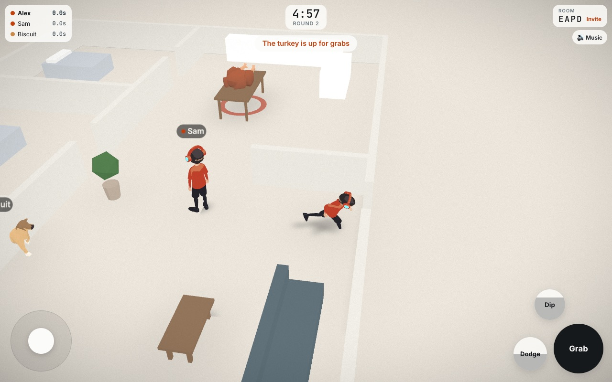

# Grab the Turkey

A multiplayer Thanksgiving game for your phone. Everyone opens the same link, types a name, and runs around trying to grab the turkey. **Every second you hold it is a point.** Rounds last five minutes. Biscuit the dog wants the turkey too.

It is open source so you can make it yours: **build the house you are eating in this year**, from photos and a floor plan, and play Grab the Turkey in it with your family after dinner.



## How to play

1. Open the site, type your name, pick a shirt color, **Start a room**.
2. Tap **Invite** and send the link (or read out the four-letter room code).
3. Anyone presses **Start the round**. A three-second countdown, then five minutes.

| | Phone | Keyboard |
|---|---|---|
| Run | the stick, bottom left | W A S D or arrows |
| Look around | drag the room; pinch to zoom | drag; wheel; Q and E |
| Grab | run into whoever has it, or press **Grab** to lunge | Space |
| Throw | hold **Throw** to wind up, let go to throw | hold Space |
| Dodge | **Dodge**: a burst in the direction you are pushing | Shift |
| Dip | **Dip**: duck under a grab (you crawl while down) | C or Ctrl |

### The physics

The turkey is heavy, so the holder has to work to keep it:

- **Slower.** With the turkey you top out at 6.0 m/s against everyone else's 6.6, and you **tire**: after 35 seconds of holding you are down to 4.7 m/s.
- **Sluggish.** The holder accelerates at 15 m/s² against 26, so turns are wide. Chasers can cut inside you.
- **Dodge** fires you sideways at 10–11.5 m/s for a fifth of a second. You can't steer it, and it has a cooldown.
- **Dip** makes you ungrabbable for 0.55 s by people and the dog, but you crawl at 40% speed.
- **Throw** winds up for up to 0.9 s, from 6.5 m/s to 14 m/s, with more loft the longer you wind. The turkey carries some of your own running speed, flies under gravity with a little drag, bounces off walls and the floor, and can land on the table. Anyone who catches it keeps it, except the thrower for the first half second.
- **No tag-backs.** Whoever just took the turkey can't lose it for 1.1 s.

Every number is in [`src/game/tuning.ts`](src/game/tuning.ts). Change them and the game changes.

### The dog

Biscuit is not a player. The host's phone runs Biscuit. Biscuit runs at whoever has the turkey (or at the turkey itself when nobody holds it) but only re-checks where it is every 0.3 s, so a well-timed dodge sends Biscuit past you. If Biscuit gets the turkey, Biscuit runs away from everyone, keeping off the walls, and drops it after seven seconds. Biscuit scores too, so don't let the dog win.

### Sound

Every sound is synthesized in the browser, so there are no audio files to license or download:

- footsteps, heavier while you carry the turkey;
- a whoosh for the dodge, a bloop for the dip, a swipe for the lunge, a rising whine while a throw winds up;
- a bright chord when you get the turkey, a sad one when it's taken, a thud when it lands, and barks from Biscuit;
- countdown beeps, a 30-second warning, ticks through the last ten seconds, and a horn (plus a flourish for the winner) at the end;
- a harvest-folk music loop that picks up when the round starts and again in the last minute.

The button under the room code cycles between music and effects, effects only, and off.

### Achievements

Drumstick Defender (hold for 10 s), Gravy Guardian (30 s), Turkey Tycoon (60 s), First Grab, Interception! (catch someone else's throw), Dog Whisperer (take it back from the dog), and Final Buzzer (holding it when time runs out). They're in [`src/audio/director.ts`](src/audio/director.ts).

## Build your own home

The game ships with two places: **The White Room** (an endless white floor, a long table and a ring of plinths) and an **Example Home** (a one-story house, open plan, three bedrooms). A place is one TypeScript file of plain data: the edge of play, the walls and furniture as boxes, where players start, and where the turkey sits.

**[docs/BUILD-YOUR-HOME.md](docs/BUILD-YOUR-HOME.md)** walks through measuring your home from a floor plan or map data, writing it down, adding a photo of the floor plan and a 3D scan, and testing it.

## How the multiplayer works

There is **no game server**. Phones find each other through public Nostr relays ([Trystero](https://github.com/dmotz/trystero)), then talk directly, peer to peer, over WebRTC. That's why the whole game deploys as static files.

- Each phone runs its own player and sends its position 20 times a second.
- One phone is the **host**, picked automatically as the lowest player id among active players. The host runs the turkey, the dog, the scores and the clock, and sends a snapshot 15 times a second. If the host leaves or locks their phone, the next player takes over from the last snapshot, and the game carries on.
- Grabs, throws and the start button are requests to the host, which decides.

Players on the same Wi-Fi connect almost every time. Two phones on some cellular networks can't reach each other directly. For that case, add a **TURN relay**: make a free Cloudflare Realtime TURN key and set `CLOUDFLARE_TURN_KEY_ID` and `CLOUDFLARE_TURN_API_TOKEN` in your Vercel project. [`api/ice.ts`](api/ice.ts) then hands each player short-lived credentials. You can also set a static TURN server at build time with the `VITE_TURN_*` variables in [`.env.example`](.env.example).

## Run it

```bash
npm install
npm run dev          # http://localhost:5173 (and on your network, for phones)
npm run build        # type-check and build to dist/
```

To play yourself in two tabs with no network, add `?transport=local` to the address. Tabs on one device then play each other over a BroadcastChannel.

In the browser console, `grabTheTurkey.game` is the live game state.

## Deploy

It's a static Vite site. Import the repo into Vercel (or any static host). [`vercel.json`](vercel.json) has the settings. The optional `/api/ice` function is the only server code, and the game works without it.

If you fork it, set `VITE_APP_ID` to something of your own so your rooms are kept apart from everyone else's.

## The code

```
src/
  env/        the places: types.ts (the format), white-room.ts, example-home.ts, index.ts (the list, collisions)
  game/       tuning.ts (every number), types.ts (the wire), authority.ts (the host: turkey, dog, scores, clock),
              net.ts (peers, host election), Controller.tsx (your player's physics and keys), store.ts
  world/      the 3D scene: Figure (the painterly walker), Dog, Turkey, Pieces (furniture), Room, CameraRig
  audio/      sound.ts (effects), music.ts (the loop), director.ts (what plays when; achievements)
  ui/         Hud (clock, scores, results), Controls (stick and buttons)
api/ice.ts    optional TURN credentials
```

## Credits

The look and the figure come from the White Room on Jeremy Fritzhand's site. The figure and its animations are from [portfolio-map-3d](https://github.com/fritzhand/portfolio-map-3d) (MIT). The dog is by [Quaternius](https://quaternius.com) and the turkey by [Kenney](https://kenney.nl), both CC0. Details are in [CREDITS.md](CREDITS.md).

MIT License. See [LICENSE](LICENSE).
